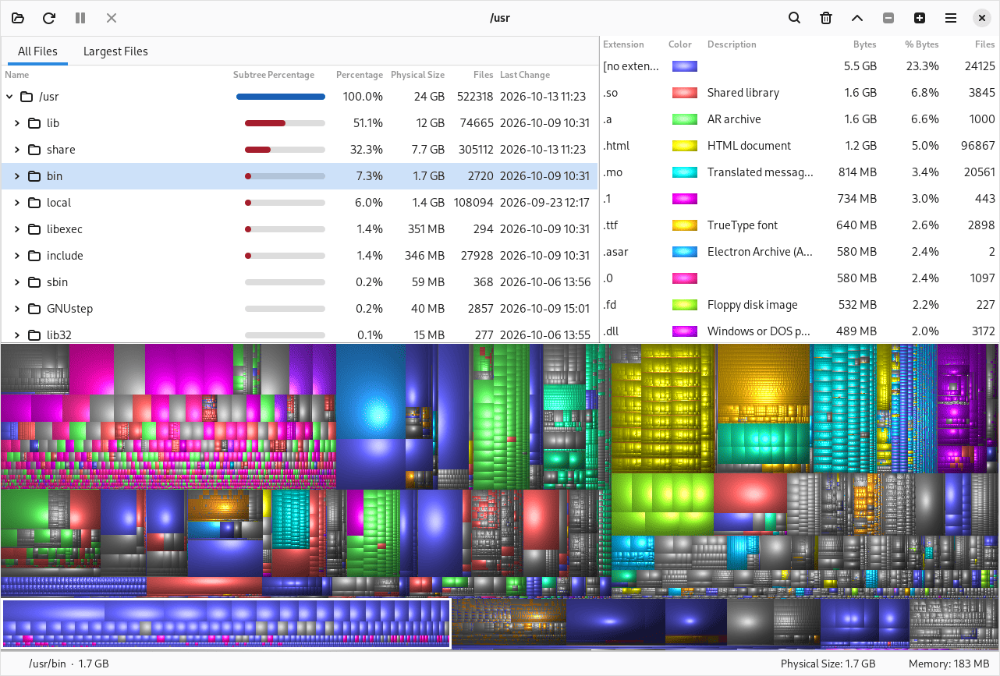
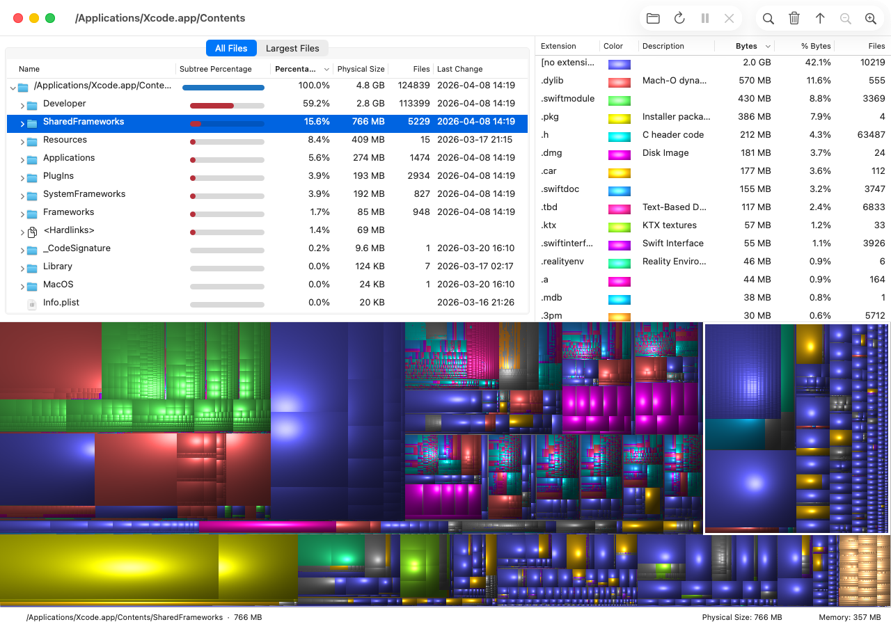

# LinDirStat

**See what is filling your disk, and clean it up. WinDirStat for Linux and macOS.**

LinDirStat is a disk usage viewer modelled closely on
[WinDirStat](https://windirstat.net). It scans a folder or a whole drive and
shows the result three ways at once, all kept in sync:

- **Directory tree**: every folder sorted by size, with percentage bars, file
  counts and last-change dates.
- **Extension list**: how much space each file type takes, each with its own
  colour.
- **Treemap**: every file drawn as a cushioned rectangle sized by its bytes and
  coloured by its type, so the largest files and folders stand out at a glance.

Click a folder and its area is framed in the treemap. Click a rectangle and
the tree jumps to that file. Click an extension and every file of that type
lights up. When you find what you are looking for, LinDirStat can open it,
show it in your file manager, or move it to the Trash after asking you first.



## Download

| Platform | Download | Requirements |
| --- | --- | --- |
| **Linux** (x86_64) | [LinDirStat-0.1.0-x86_64.AppImage](https://github.com/danjboyd/LinDirStat-releases/releases/latest) | glibc 2.38 or newer and GTK 4, for example Debian 13, Ubuntu 24.04 or newer, Fedora 39 or newer. Tested on Debian 13. |
| **macOS** (Apple Silicon and Intel) | [LinDirStat-0.1.0-macos-universal.dmg](https://github.com/danjboyd/LinDirStat-releases/releases/latest) | macOS 13 Ventura or newer. |

All releases are listed at
[danjboyd/LinDirStat-releases](https://github.com/danjboyd/LinDirStat-releases/releases).

### Linux

```sh
chmod +x LinDirStat-*-x86_64.AppImage
./LinDirStat-*-x86_64.AppImage
```

The AppImage bundles GNUstep and the Adwaita theme, so it looks at home on
GNOME. It does not need FUSE 2; on a system without FUSE, run it with
`--appimage-extract-and-run`.

The AppImage updates itself: it checks for a new release once a day and asks
before installing anything (**Help › Check for Updates…** checks now).
Updates are signed, and a download whose signature does not match is refused.
AppImageUpdate and AppImageLauncher can update it too.

### macOS

Open the DMG and drag LinDirStat to Applications.

The app is not notarized by Apple yet, so the first launch is blocked with a
message that Apple cannot check it for malicious software. To open it anyway:

1. Try to open LinDirStat once, then dismiss the message.
2. Open **System Settings › Privacy & Security**, scroll down to the message
   about LinDirStat and click **Open Anyway**.

Or, in Terminal: `xattr -dr com.apple.quarantine /Applications/LinDirStat.app`

To scan your whole disk, give LinDirStat **Full Disk Access** in
**System Settings › Privacy & Security**. Without it, macOS hides some folders
from every app, and LinDirStat tells you when that happens. The macOS build
does not update itself yet; check the releases page for new versions.



## Features

LinDirStat follows WinDirStat's behaviour wherever the platform allows, and
uses WinDirStat's own source as its reference. Highlights:

- **Fast scanning** across several threads, with Suspend, Resume and Stop.
  Scan a folder, one drive, or every local drive at once.
- **Correct sizes**: physical (on-disk) size by default, logical size on
  request. Hard links are counted once, and other filesystems and symbolic
  links are left out unless you ask for them.
- **WinDirStat's treemap**, ported from its `CTreeMap` and pixel-identical to
  it, with zoom, the selection frame, and every style setting: cushion
  shading, brightness, height and light source.
- **Largest Files** and **Duplicate Files** tabs. Duplicates are found during
  the scan by size, then confirmed by hash.
- **Search** by name, with regular expressions.
- **Free space and unknown space** shown as items in the tree and treemap
  (F6 and F7).
- **File Watcher**, which lists files created, changed or deleted in the
  scanned tree while you watch.
- **Clean-up actions**: open, Open With, show in the file manager, open a
  terminal there, copy the path, move to Trash or delete permanently, empty
  the Trash, and WinDirStat-style custom clean-up commands. Every destructive
  action asks first.
- **CSV export and import** in WinDirStat's format, so results can move
  between WinDirStat and LinDirStat.
- **Command line**: `LinDirStat ~/Downloads` scans a folder, and
  `LinDirStat --savetocsv usage.csv /srv` scans and saves without opening a
  window.
- **Translations** from WinDirStat's language files.
- **A native app on each platform**: GNUstep with the Adwaita theme on
  Linux, Apple's AppKit on macOS, light and dark.

[docs/windirstat-parity.md](docs/windirstat-parity.md) compares each part of
the app with WinDirStat, and notes where LinDirStat deliberately differs.

## Building from source

LinDirStat is written in Objective-C. The same sources build for both
platforms.

**macOS** needs Xcode or the Command Line Tools:

```sh
make -C macos          # macos/build/LinDirStat.app, universal
make -C macos run
make -C macos test
```

**Linux** builds with GNUstep, using
[gnustep-cli-new](https://github.com/danjboyd/gnustep-cli-new) for the
toolchain, plus [libs-OpenSave](https://github.com/danjboyd/libs-OpenSave) and,
for the GNOME look,
[the Adwaita GNUstep theme](https://github.com/danjboyd/plugins-themes-Adwaita).
[docs/development.md](docs/development.md) has the build and test commands.

Packages are built with
[gnustep-packager](https://github.com/danjboyd/gnustep-packager): see
[docs/packaging.md](docs/packaging.md) for the AppImage and the DMG, and
[docs/updates.md](docs/updates.md) for the AppImage updater.

## Reporting problems

Please [open an issue](https://github.com/danjboyd/LinDirStat/issues/new)
with your platform and version, what you scanned, and what you expected to
see. **Help › Report a Bug…** in the app opens the same page.

## License

LinDirStat is free software under the GNU General Public License, version 2
or (at your option) any later version. See [COPYING](COPYING).

LinDirStat is an independent project, not affiliated with the WinDirStat
team. It reuses WinDirStat's translations, which are GPL as well. The
WinDirStat source in [references/WinDirStat](references/WinDirStat) is
included as reference only. Third-party notices for everything the packages
bundle ship inside the AppImage and the DMG.
